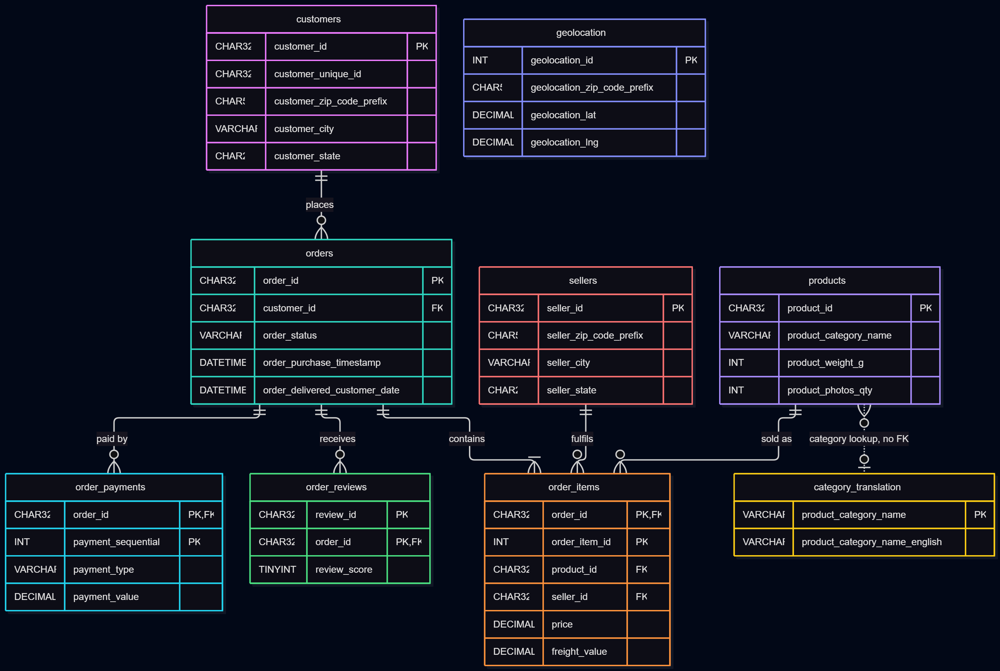
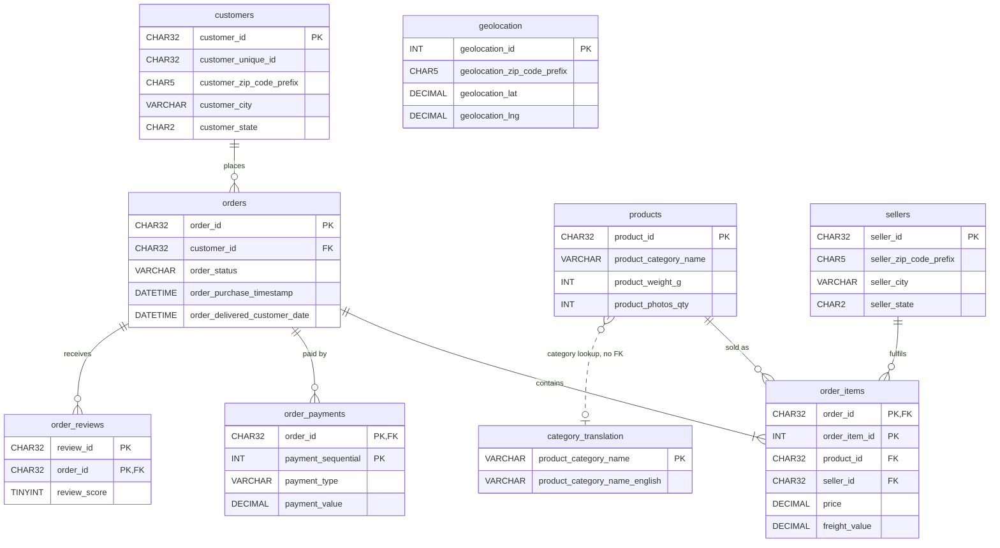

# Portfolio 1: Database Design and Modelling (7 marks)

## Objective
Design a relational database for the selected case study (an Olist-style online marketplace, see the main [README](../README.md)), with an ER diagram, relational schema, keys, constraints and a normalisation explanation, then load real data into it.

## Files in this folder

**Scripts and documents**
- `schema.sql`: table definitions (PK, FK, CHECK constraints). Safe to re-run.
- `load_data.sql`: loads the 9 Olist CSV files into the tables. Safe to re-run (about 6 minutes).
- `verify_data.sql`: row counts and spot-check queries
- `design_evidence.sql`: three queries that justify the design decisions
- `normalisation.md`: 1NF to 3NF explanation with a worked example

**Diagram and screenshots** (all stored in this folder)
- `P1-database-designer-diagram.png`: ER diagram
- `P1-database-designevidence01-mysql-version.png`: MySQL server version
- `P1-database-designevidence02-tables-created.png`: tables listed and `orders` structure
- `P1-database-designevidence03-foreign-keys.png`: foreign keys from `information_schema`
- `evidence04-data-loaded.png`: output of `load_data.sql`
- `evidence05-row-counts.png`: row count per table
- `evidence_total_row.png`: repeated `review_id` values
- `Evidence_product_category_name.png`: categories with no translation
- `evidence_missing_cust.png`: customer zip codes missing from `geolocation`
- `Setting_up_MySQL_Service.png`: starting the MySQL80 service
- `Github_cloning_to_local_machine.png`: cloning the repository
- `MySQL_Workbench_Schema.png`: running `schema.sql` in Workbench
- `MySQL_Workbench_ShowTables.png`: `SHOW TABLES` output
- `Olist_Ecorm_Data_Preview.png`: preview of the Olist CSV data

## Case study summary
An online marketplace where customers place orders containing products sold by sellers, pay (sometimes in several parts) and leave reviews. The data is the public Olist Brazilian E-Commerce dataset (about 100k orders, 9 CSV files).

## Tables

| Table | Primary key | Foreign keys | Purpose |
|---|---|---|---|
| `customers` | `customer_id` | none | Buyers (`customer_unique_id` identifies the real person) |
| `sellers` | `seller_id` | none | Merchants |
| `products` | `product_id` | none | Product catalogue |
| `orders` | `order_id` | `customer_id` | One purchase |
| `order_items` | `order_id`, `order_item_id` | order, product, seller | Lines within an order |
| `order_payments` | `order_id`, `payment_sequential` | order | Payments (one order can have several) |
| `order_reviews` | `review_id`, `order_id` | order | Customer feedback |
| `category_translation` | `product_category_name` | none | Lookup: Portuguese to English category names |
| `geolocation` | `geolocation_id` | none | Lookup: zip-code coordinates (about 1M rows) |

## ER diagram

The same model in Mermaid (GitHub renders it live). Column lists are shortened for readability; full definitions are in `schema.sql`.

## How to run

**Requirements:** MySQL Community Server 8.0.16 or later (CHECK constraints are enforced from this version) and MySQL Workbench.

1. Clone the repository (see `Github_cloning_to_local_machine.png`) and make sure the MySQL80 service is running (see `Setting_up_MySQL_Service.png`).
2. Open MySQL Workbench and connect to the local MySQL server.
3. Open `schema.sql` (File > Open SQL Script) and run the whole script. It creates the database `olist_marketplace` and all 9 tables.
4. Download the Olist dataset from Kaggle and place the 9 CSV files in the folder MySQL allows for imports. Find it with `SHOW VARIABLES LIKE 'secure_file_priv';`. The CSV files are not committed to GitHub.
5. Run `load_data.sql`. If your import folder differs from `C:/ProgramData/MySQL/MySQL Server 8.0/Uploads/`, use Find & Replace on the path first. The script takes about 6 minutes, most of it loading `geolocation`.
6. Run `verify_data.sql` to check row counts and sample queries.
7. Optionally run `design_evidence.sql` to reproduce the design findings below.

## How it was tested

| Check | Command | Expected | Observed |
|---|---|---|---|
| Server version | `SELECT VERSION();` | 8.x | 8.0.46 |
| Schema script | run `schema.sql` | no errors | 15 statements executed successfully |
| Tables created | `SHOW TABLES;` | 9 tables | 9 tables |
| Foreign keys exist | query on `information_schema.KEY_COLUMN_USAGE` | 6 rows | 6 rows |
| Data load | run `load_data.sql` | no errors | 22 statements executed successfully |
| Row counts | `verify_data.sql` | match the source files | all 9 tables match (see below) |
| Order statuses | `GROUP BY order_status` | only the 8 allowed values | 8 values, totalling 99,441 orders |
| Zip-code format | length check on `customers` | no rows | no rows returned |

The six foreign keys are: `order_items` to `orders`, `products` and `sellers`; `order_payments` to `orders`; `order_reviews` to `orders`; and `orders` to `customers`.

## Data loading

All 9 CSV files were loaded with `LOAD DATA INFILE`, parent tables first. Rows loaded per table (output in `evidence04-data-loaded.png` and `evidence05-row-counts.png`):

| Table | Rows |
|---|---|
| customers | 99,441 |
| sellers | 3,095 |
| products | 32,951 |
| orders | 99,441 |
| order_items | 112,650 |
| order_payments | 103,886 |
| order_reviews | 99,224 |
| category_translation | 71 |
| geolocation | 1,000,163 |

**How the data problems were handled**
- **Empty cells** in date and number columns are converted to NULL with `NULLIF(@value, '')`. Without this, strict mode rejects the empty text. As a result, 610 products have no category and 2,965 orders have no delivery date, which are genuine gaps in the data rather than load errors.
- **Zip codes** are padded with `LPAD(..., 5, '0')` so leading zeros are never lost.
- **Quoting:** some CSV fields are quoted and others are not, which `OPTIONALLY ENCLOSED BY '"'` handles.
- **Column names:** Kaggle's misspelt `lenght` columns are loaded by position into correctly named columns.

## Design evidence from the data

Queries are in `design_evidence.sql`.

| Finding | Result | Screenshot | Design decision it supports |
|---|---|---|---|
| `order_reviews` has 99,224 rows but only 98,410 distinct `review_id` values | `review_id` repeats | `evidence_total_row.png` | Composite primary key `(review_id, order_id)` |
| Two product categories have no English translation: `pc_gamer` and `portateis_cozinha_e_preparadores_de_alimentos` | 2 categories | `Evidence_product_category_name.png` | No foreign key from `products` to `category_translation` |
| 157 customer zip prefixes do not exist in `geolocation` | 157 zip codes | `evidence_missing_cust.png` | No foreign key from `customers` to `geolocation` |

The full normalisation argument is in [`normalisation.md`](normalisation.md).

## Design choices and challenges

**Choices**
1. **Composite primary keys** on `order_items`, `order_payments` and `order_reviews`, because one ID alone does not identify a row.
2. **CHECK constraints** protect data quality: review scores 1 to 5, no negative prices or payment values, and fixed lists of valid order statuses and payment types.
3. **Lookup tables without foreign keys**, because the source data is incomplete (see the evidence table above). This is a deliberate trade-off between referential integrity and data completeness.
4. **No extra indexes yet**, only the keys. Portfolio 2 measures queries first, then adds indexes and compares.
5. **Column rename:** Kaggle's typo `lenght` was corrected to `length` in `products`.
6. **`customer_id` vs `customer_unique_id`:** Olist creates a new `customer_id` for every order, so `customer_unique_id` is used to identify repeat buyers.

**Challenges**
- **MySQL service:** the MySQL80 service had to be started manually from an administrator Command Prompt (`net start MySQL80`) before Workbench could connect.
- **ER diagram tool:** MySQL Workbench 26.10.0 did not offer the Reverse Engineer / EER diagram options I expected, so the ER diagram was produced with Mermaid instead.
- **Silent data loss during import:** the first load reported no errors, but every table was one row short (customers 99,440 instead of 99,441, and so on). The foreign key on `orders` exposed it by rejecting an order whose customer was missing. That customer was the first data row of its file. The cause was `ESCAPED BY '"'` in `LOAD DATA`: when MySQL skips the header with `IGNORE 1 LINES`, it treated the closing quote of the header as escaping the line break, so the first data row was swallowed with the header. Setting `ESCAPED BY ''` fixed it, and after reloading all counts matched. This is a practical reason for keeping foreign key constraints, since they caught a problem that produced no error message.

## References
- Olist (2018). *Brazilian E-Commerce Public Dataset by Olist.* Kaggle. CC BY-NC-SA 4.0.
- MySQL 8.0 Reference Manual: CREATE TABLE, CHECK constraints, FOREIGN KEY constraints, LOAD DATA.
