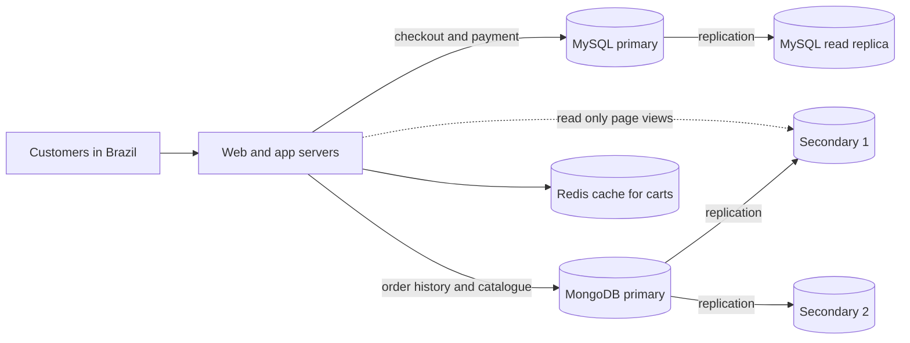

# Cloud Deployment (Portfolio 5)

## 1. What was deployed

The NoSQL part of the case study (Portfolio 4) runs on **MongoDB Atlas**, MongoDB's managed cloud service.

| Item | Value (from the Atlas screenshots) |
|---|---|
| Cloud provider and region | AWS, **Paris (eu-west-3)** |
| Tier | **Free** (M0) |
| MongoDB version | 8.0.36 |
| Cluster | one cluster, one replica set of **3 members** (see `replication-and-consistency.md`) |
| Availability zone of the connected node | `euw3-az3` |
| Backups, auto-scaling | both **off** (free-tier defaults) |
| Client | MongoDB Compass and its built-in shell, from a machine in Lagos |

Evidence: `AWS_Region.png` (version, region and tier), `B_the_replica_set.png` (`db.hello()` output with the provider and zone tags).

## 2. How it was set up

1. Created a MongoDB Atlas account and a free cluster, choosing AWS as the provider.
2. Created a **database user** (password authentication) under Database Access.
3. Added the client's address to the **IP access list** under Network Access.
4. Connected from MongoDB Compass using the connection string Atlas provides. The string contains credentials and is not stored in the repository.
5. Created the database `olist_nosql` and imported the JSON exported from MySQL (Portfolio 4).

## 3. Security configuration

| Control | Setting | Evidence |
|---|---|---|
| Network access | An IP access list with one entry, a single address (`/32`). Only that address can connect to the cluster | `Network_Access.png` |
| Authentication | One database user using SCRAM (username and password) | `Database_Access.png` |
| Authorisation | That user has the broad `atlasAdmin` role on all resources | `Database_Access.png` |
| Encryption in transit | Atlas clusters only accept encrypted (TLS) connections | Atlas documentation |

**Improvement for a real system.** The `atlasAdmin` role is far more than an application needs. A production application should connect with a dedicated user that has only `readWrite` on the `olist_nosql` database, and the IP access list should list only the application servers (or use private networking), never `0.0.0.0/0`.

## 3.1 Limits of the free tier

- **512 MB** of storage; the 20,000-order sample takes about 15 MB (see `sharding-design.md`).
- **No sharding and no failover testing**, which need a paid tier. Those topics are covered as design and discussion.
- Shared resources, so performance is not representative of production.

## 4. Choosing a region

The cluster is in Paris because it was the nearest free-tier option to the client. Every write the client made took about **185 ms** end to end (block E of the write-concern test), which is almost entirely the network round trip between Lagos and Paris, not database work.

For the case study itself, the customers are in **Brazil**, so a production deployment should sit in a region close to them (AWS has a São Paulo region), so that page loads and writes avoid that delay.

## 5. Proposed architecture for the whole case study

This is a **design proposal**, not something that was built. Only the MongoDB replica set on Atlas and the local MySQL database were actually run.

| Component | Role | Why |
|---|---|---|
| MySQL primary | Stock, payments and the order transaction | Needs the transactions and locking of Portfolio 3 |
| MySQL read replica | Reports and dashboards | Keeps heavy queries off the primary |
| MongoDB replica set | Order history and product catalogue | Read as whole documents; three copies for availability |
| MongoDB secondaries | Read-only page views | Spreads read load (data may lag slightly) |
| Redis | Shopping carts and sessions | Fast key-value access (see `P4-nosql/data-model.md`) |
