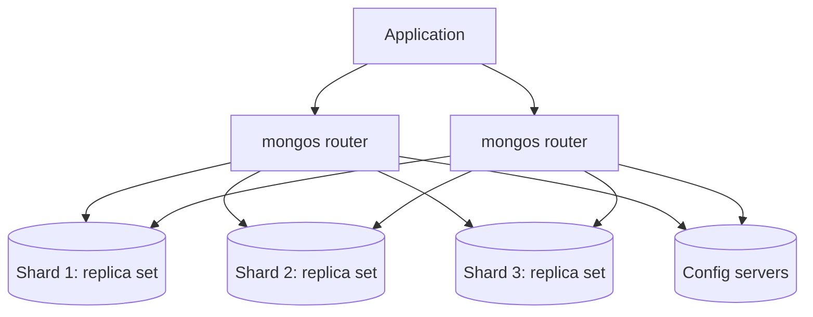

# Sharding Design (Portfolio 5)

Sharding is **not available on the free Atlas tier**, so this is a design backed by measurements taken from the real data, not a running setup.

## 1. What sharding is

Sharding splits a collection across several servers called **shards** (each one is itself a replica set), so that data size and write load can grow beyond what one server can handle. A **router** (`mongos`) receives the application's queries and sends each one to the right shard(s), and **config servers** store which piece of data lives where. Documents are divided into **chunks** by a **shard key**, and a balancer moves chunks between shards to keep them even.

## 2. Does this data need sharding?

Measured on the 20,000-order sample (`H_how_big_is_the_data.png`):

| Measure | Value |
|---|---|
| Documents | 20,000 |
| Average document size | 830 bytes |
| Data size | 15.8 MB |
| Index size | 1.7 MB |

The full dataset has 99,441 orders. At the same average size that is about **80 MB** of data, far below the 512 MB free-tier limit and trivial for a single replica set. **Sharding is not needed at this scale.** It becomes worthwhile when the data or write rate outgrows one server (typically hundreds of gigabytes or more), so this design describes how to do it when that point arrives, for example if the shop grows to millions of orders.

## 3. Choosing the shard key

A good shard key has **many distinct values**, spreads documents **evenly**, avoids all new writes landing on one shard, and matches how queries filter, so that most queries touch only one shard.

Measurements from the sample (`G1`, `G2` and `G3` screenshots):

| Measure | Result |
|---|---|
| Orders by customer state | 27 states; São Paulo **41.9%** (8,375 of 20,000), Rio de Janeiro 12.8%, Minas Gerais 11.4%. The top three states hold 66.1% |
| Distinct customers (`customer.unique_id`) | **19,850** distinct values across 20,000 orders |
| Most orders by one customer | 4 |
| Customers with exactly one order | 19,704 |
| Order dates | from 4 Sep 2016 to 17 Oct 2018 (about 25 months), always increasing |

**Candidates**

| Shard key | What the data says | Verdict |
|---|---|---|
| `customer.state` | Only 27 values and one state holds 41.9% of orders. All documents of a state share one key value and cannot be split, so one shard would carry a huge share | **Reject**: low cardinality and strong skew |
| `purchased_at` (ranged) | Dates only ever increase, so every new order falls in the newest range and one shard takes all the writes (a "hot" shard). It does suit date-range queries | **Reject** as the sole key |
| `_id` (order id), **hashed** | Order ids are random strings; hashing spreads writes evenly. But queries by customer or by date must ask every shard | Good for balance, poor for customer queries |
| `customer.unique_id`, **hashed** | 19,850 distinct values, no customer dominates (maximum 4 orders), so hashing gives an even spread. All of one customer's orders live on **one shard**, so "show this customer's order history" goes to a single shard | **Recommended** |

**Recommended key:** `{ "customer.unique_id": "hashed" }` on the `orders` collection.

## 4. Trade-offs of the recommendation

| Query type | What happens |
|---|---|
| A customer's order history (filters on `customer.unique_id`) | **Targeted**: only one shard is asked |
| Lookup of one order by `_id` alone | Sent to **all** shards (scatter-gather), because the router cannot tell where it lives. Mitigation: include the customer id in order links, or keep a small lookup collection from order id to customer id |
| Reports: canceled orders per month, revenue by category, top sellers | **Scatter-gather**: every shard works on its part and results are merged. Acceptable for analytics, which can run on secondaries or a dedicated analytics node |

Other notes:
- `products` and `sellers` are small reference collections and would stay **unsharded**.
- The shard key is hard to change later, so it should be chosen from real query patterns before the collection grows large.
- The number of shards should be chosen from actual size and throughput; two or three would be a typical start.

## 5. Sharding versus replication

They solve different problems and are combined: replication gives **availability and read scaling** (copies of the same data), sharding gives **capacity and write scaling** (different data on different servers). Each shard in the diagram is itself a replica set like the one demonstrated in `replication-and-consistency.md`.
